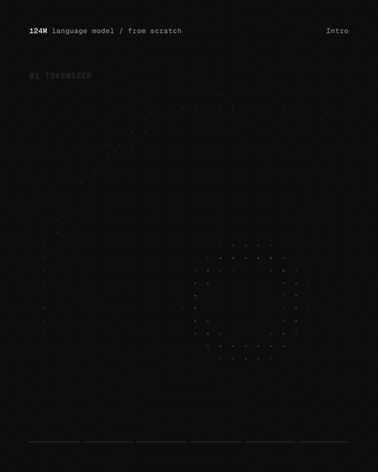
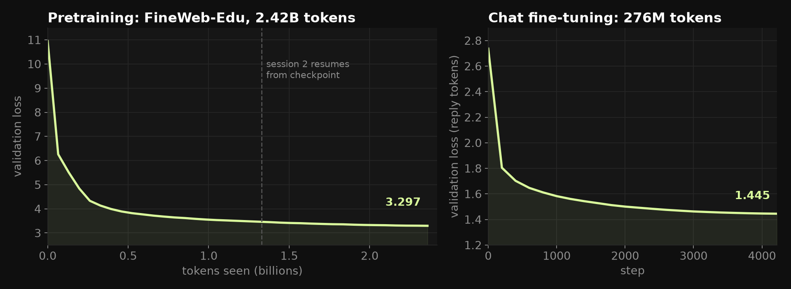
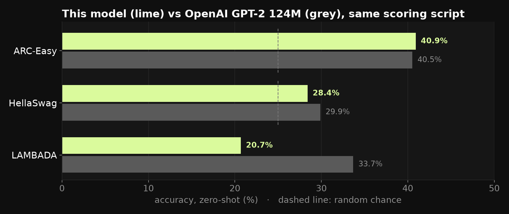

# GPT-2-size chat model, built from scratch

A 124M-parameter language model and its tokenizer, written from scratch and trained on Kaggle's
free T4 GPUs for $0. It was pretrained on 2.42B tokens of educational web text, then fine-tuned
on 276M tokens of conversations, and it now chats on a laptop CPU.

**[Try it in your browser](https://huggingface.co/spaces/V1jey04/gpt2-124m-from-scratch)** (runs on your device, nothing to install) ·
**[Model weights and card](https://huggingface.co/V1jey04/gpt2-124m-from-scratch)**



No `transformers` or `tokenizers` library is used to build or train the model. The tokenizer is
standard-library Python, and the model is plain PyTorch.

| Part | File | What it does |
|---|---|---|
| Tokenizer | `tokenizer/bpe.py` | Byte-level BPE: 50,000 learned pieces plus 4 chat tokens |
| Model | `model/gpt.py` | GPT-2-small shape: attention, MLP, blocks, loss, KV-cached sampling |
| Training | `train.py` | Two-GPU DDP, fp16, gradient accumulation, exact checkpoint and resume |
| Data | `data/` | Streams, tokenizes and shards FineWeb-Edu and the chat datasets |
| Chat | `chat.py` | Terminal chat with streaming output |
| Browser demo | `hf_release/web/` | ONNX Runtime Web + a JavaScript port of the tokenizer, KV cache in a web worker |
| Benchmarks | `benchmark.py` | Zero-shot comparison against OpenAI's GPT-2 124M |

## Results



| Stage | Data | Compute | Validation loss |
|---|---|---|---|
| Pretraining | 2.42B tokens of FineWeb-Edu (9,236 steps × 262,144 tokens) | 2× T4, 22.6 h, two Kaggle sessions | 10.96 → 3.297 |
| Chat fine-tuning | 276M tokens of SmolTalk, Dolly and OpenAssistant (4,217 steps) | 2× T4, 2 h 40 min | 2.74 → 1.445 |

### Against OpenAI's GPT-2 (124M)



| Test (zero-shot) | Questions | This model | GPT-2 124M |
|---|---|---|---|
| ARC-Easy, grade-school science | 2,376 | **40.9%** | 40.5% |
| HellaSwag, commonsense sentence endings | 10,042 | 28.4% | **29.9%** |
| LAMBADA, last word of a story | 5,153 | 20.7% | **33.7%** |
| WikiText-2, bits per byte (lower is better) | full test set | 1.324 | **1.020** |

Both models are scored by the same script (`benchmark.py`). Multiple-choice options are compared
by loss per byte, so the two different tokenizers don't bias the result. The model tested here
is the chat-tuned one, against GPT-2's base model.

The model is level with GPT-2 on science questions, which matches its educational training text.
It is behind on LAMBADA and WikiText, which reward the long, story-like web text GPT-2 was
trained on.

### A real conversation

```
you> What is the capital of France?
bot> The capital of France is Paris. It is a city known for its historical landmarks and cultural institutions.
```

At this size it still states wrong facts with confidence, so treat it as a demo, not a source.

## How it is built

**Tokenizer.** Byte-level BPE starts from the 256 byte values and learns 49,744 merges. Training
keeps an inverted index from byte pairs to the words that contain them, plus a max-heap with
lazy deletion, so each merge touches only the affected words. `encode()` never turns plain text
into special tokens, so a user who types `<|end|>` cannot break the chat format.

**Model.** 12 layers, 12 heads, 768 dimensions, a 1,024-token context, learned position
embeddings and tied input and output embeddings. The vocabulary is padded to 50,304 rows, giving
124,475,904 parameters in total. Attention uses `F.scaled_dot_product_attention`, and residual
projections start with a `(2 × n_layer)^-0.5` scaled init.

**Training on free GPUs.** `torchrun` DDP on 2× T4 with fp16 autocast and a gradient scaler.
Gradient accumulation reaches 262,144 tokens per step, and `torch.compile` raises speed to about
33k tokens/s. Kaggle ends sessions at 12 hours, so the script stops itself at 11.25 h. It
checkpoints the model, optimizer, scaler and the loader's exact shard position, then resumes
there in the next session.

**Chat fine-tuning.** Conversations use the layout
`<|bos|><|user|>…<|end|><|assistant|>…<|end|>`. The loss mask covers only the assistant's tokens
and their closing `<|end|>`, so the model learns to answer, not to imitate users.

**Inference.** A per-layer KV cache means each new token costs one row of attention. Sampling
supports temperature, top-k, top-p and a repetition penalty.

**In the browser.** `scripts/export_onnx.py` exports one ONNX graph that handles both the prompt and
each new token through the KV cache, checks it against PyTorch, and quantises it to per-channel
int8 (126 MB). Per-tensor int8 drifted from the full-precision model within a few tokens;
per-channel stayed close. The tokenizer is ported to JavaScript and gives the same ids as the Python
version on 219 test strings, including accents, CJK, emoji and code. The demo runs at about 40
tokens/s on a laptop CPU.

## Run it

```bash
pip install torch
# get model.safetensors and config.json from the Hugging Face model repo, or use your own checkpoint
python chat.py --ckpt final.pt --tokenizer tokenizer.json
```

`tokenizer.json` is in this repo. `scripts/export_hf.py` turns a training checkpoint into the
`model.safetensors` + `config.json` pair published on Hugging Face.

## Reproduce it on Kaggle

This is the pipeline used for this run. Kaggle mounts inputs at
`/kaggle/input/datasets/<user>/<name>/`, so the notebooks find files with a recursive glob.

1. **Code.** Upload this repo as a private Kaggle dataset.
2. **Tokenizer** (CPU notebook):
   ```
   python data/make_tokenizer_sample.py --out /kaggle/tmp/tok_sample.txt --max-bytes 1500000000
   python -m tokenizer.bpe train --input /kaggle/tmp/tok_sample.txt --vocab-size 50000 --out tokenizer.json
   ```
3. **Pretraining data** (CPU notebooks): follow `data/README.md` to build `train_*.bin` and
   `val_*.bin` shards. The shards are raw uint16 token ids, about 9.2B tokens over three datasets.
4. **Pretraining** (GPU T4 x2). Run "Save & Run All" so it keeps going with the browser closed:
   ```
   PYTORCH_CUDA_ALLOC_CONF=expandable_segments:True torchrun --nproc_per_node=2 train.py \
       --data-dir /kaggle/input --out-dir /kaggle/working/run --batch-size 8 --compile --max-steps 9500
   ```
   For each later session, attach the previous output and add `--resume <path>/run/ckpt.pt`. Keep
   `--max-steps` the same, because the learning-rate schedule depends on it. Batch size 16 runs
   out of memory on a T4; batch 8 with gradient accumulation gives the same 262,144-token step.
5. **Chat data and fine-tuning:**
   ```
   python data/prepare_chat.py --tokenizer tokenizer.json --out /kaggle/working/chat
   torchrun --nproc_per_node=2 train.py --data-dir <chat shards> --out-dir /kaggle/working/chat \
       --init-from <pretrain run>/ckpt.pt --chat-mask --tokenizer tokenizer.json --lr 5e-5 \
       --warmup-steps 100 --total-batch-tokens 65536 --max-steps 4217 --eval-every 200 --batch-size 8 --compile
   ```
   One pass over the data is `train tokens in meta.json / 65536` steps.
6. **Benchmarks** (any machine): `python benchmark.py --ckpt final.pt --tokenizer tokenizer.json`

## Tests

Checked on CPU with a tiny model and corpus:
- The tokenizer's merges match a naive reference BPE, and text round-trips exactly.
- The parameter count is 124,475,904, and cached generation matches a full forward pass.
- Loss goes down, stop-and-resume works, two-process DDP works, and the chat mask covers only assistant text.
- The data pipeline passes 13 offline tests with fake data (`data/test_pipeline.py`).

## Data and licences

Code: MIT. Training data: [FineWeb-Edu](https://huggingface.co/datasets/HuggingFaceFW/fineweb-edu) (ODC-By),
[SmolTalk](https://huggingface.co/datasets/HuggingFaceTB/smoltalk) (Apache 2.0),
[Dolly 15k](https://huggingface.co/datasets/databricks/databricks-dolly-15k) (CC BY-SA 3.0) and
[OpenAssistant oasst1](https://huggingface.co/datasets/OpenAssistant/oasst1) (Apache 2.0).
